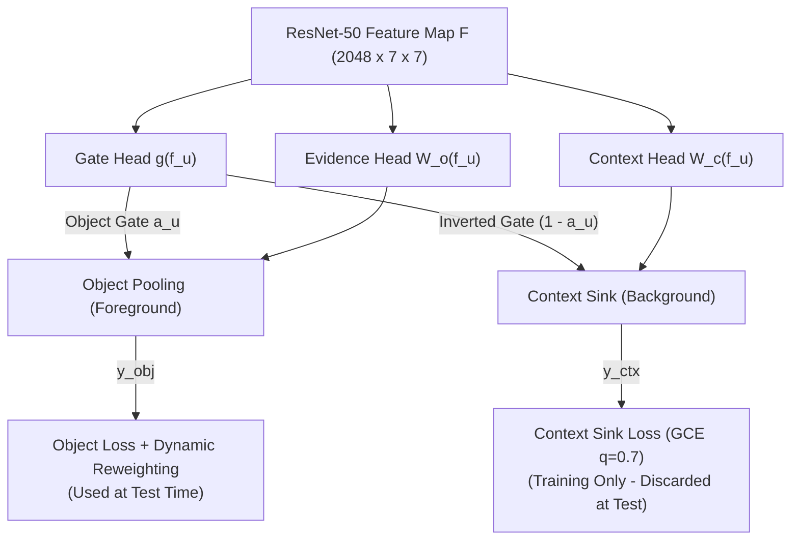

# Object–Context Decoupled Pooling (OCDP): Comprehensive Project Explainer & Research FAQ

> **Document Type**: Technical Reference & Conceptual Guide  
> **Target Audience**: Researchers, Engineers, Academic Reviewers  
> **Repository**: `ocdp-shortcut-learning`  
> **Authoritative Protocols**: [`AGENTS.md`](file:///e:/Greeshma/ocdp-shortcut-learning/AGENTS.md) & [`.agents/rules/evaluation-protocol.md`](file:///e:/Greeshma/ocdp-shortcut-learning/.agents/rules/evaluation-protocol.md)

---

## 1. Executive Summary & Big Picture

### The Core Problem: Shortcut Learning & Spurious Correlations
Standard Deep Neural Networks (DNNs) trained via Empirical Risk Minimization (ERM) are notorious for exploiting **shortcuts** (spurious correlations). Instead of learning invariant semantic features defining an object, networks latch onto background textures or contextual artifacts that happen to correlate with class labels in the training set.

In the canonical **Waterbirds** benchmark:
- **95% of waterbirds** appear on water backgrounds (lakes, oceans).
- **95% of landbirds** appear on land backgrounds (forests, trees).
- **The Shortcut**: The model learns: *"Blue/Water texture = Waterbird; Green/Tree texture = Landbird."*
- **The Failure**: When deployed on minority combinations (e.g., a **waterbird on land** or a **landbird on water**), accuracy drops from ~95% overall down to **~60% or worse** on the worst-performing group.

### Why Standard Architectures Fail: The GAP Bottleneck
Since the introduction of Network-in-Network and ResNet, virtually all computer vision classifiers end with **Global Average Pooling (GAP)**:
$$\text{GAP}(F) = \frac{1}{HW} \sum_{u=1}^{HW} f_u$$
where $f_u \in \mathbb{R}^{2048}$ is the spatial feature vector at grid location $u$ ($7 \times 7$ grid).

**GAP mathematically forces foreground object features and background context features to collapse into a single unified vector.** Once merged, the downstream linear classifier cannot disentangle which features came from the bird and which came from the background water.

### The Proposed Solution: Object–Context Decoupled Pooling (OCDP)
OCDP replaces GAP with a drop-in architectural head on top of a frozen or fine-tuned ResNet-50. It splits spatial feature maps into two distinct computational streams:



1. **Object Gate ($a_u \in (0, 1)$)**: A lightweight spatial attention module predicting whether grid location $u$ is foreground object vs. background.
2. **Context Sink ($\hat{y}_{\text{ctx}}$)**: Pools features from the *spatial complement* $(1 - a_u)$ and is trained with **Generalized Cross-Entropy (GCE, $q=0.7$)**. GCE hyper-activates on easy, majority samples, compelling the sink to aggressively "absorb" the background shortcut.
3. **Dynamic Sample Reweighting ($w_i$)**: Samples where the context sink makes high errors (bias-conflicting samples like waterbirds on land) are dynamically assigned higher training weight ($w_i > 1$) in the object path.
4. **Area Prior Regularization**: Penalizes the object gate if its spatial coverage collapses to 0% or expands to 100%, guiding it toward a realistic object area ($\rho \approx 0.30$).
5. **Test-Time Decoupling**: At inference time, the context sink is **completely discarded**. Predictions rely strictly on the object path $\hat{y}_{\text{obj}}$.

---

## 2. Academic Rigor: Is This Worth a Journal Paper?

### The Reviewer Defense: *"Why not just use segmentation masks or bounding boxes during training?"*

If a reviewer asks why we do not simply train the model with segmentation annotations or crop out the background, here is the fundamental scientific justification:

#### A. The "Annotation Trap" and Scalability
- Dense pixel-level segmentation masks and bounding boxes are **prohibitively expensive**. In real-world applications (e.g., satellite imagery, autonomous driving, web-scale image search), annotating thousands of pixel boundaries costs massive human labor and financial budget.
- In **medical imaging** (e.g., chest X-rays where models cheat using hospital metal tokens, chest tubes, or scanner calibration marks), radiologists cannot practically segment every anatomical region and artifact on 100,000+ scans.

#### B. The "Unknown Shortcut" Dilemma
- To mask or crop the object, **you must already know what the shortcut is in advance**.
- In practical deployments, engineers rarely know what shortcut the model is exploiting until after deployment failure occurs. You cannot ask human labelers to annotate or mask a spurious correlation that you do not yet know exists.

#### C. The Supervision Tiers Hierarchy
In benchmark literature (Group DRO, DFR, JTT, SubpopBench), methods are classified into three strict supervision tiers:

| Tier | Supervision Level | Description | Practical Feasibility |
| :---: | :--- | :--- | :---: |
| **Tier 1 (T1)** | Group labels in train & val | Every image has explicit shortcut labels (e.g. $g = 2y + \text{place}$) or masks. | Very Low (Impractical) |
| **Tier 2 (T2)** | Group labels in val only | Training has only class labels, but validation has group annotations for tuning. | Low (Moderate) |
| **Tier 3 (T3)** | **No group labels anywhere** | **Only standard class labels ($y$) exist in both train and validation.** | **High (Real-World Standard)** |

> **Why OCDP is Significant**: OCDP achieves high worst-group accuracy under **Tier 3 (Label-Free)** supervision. It discovers and isolates the foreground object automatically from class labels alone, without ever touching group labels, bounding boxes, or segmentation masks during training.

### Why OCDP is High-Impact for Top Journals / Conferences
1. **Drop-in Inductive Bias**: Rather than requiring complex multi-stage pipelines (e.g., training a biased model, extracting Grad-CAM, clustering masks, and retraining a second model), OCDP operates **end-to-end** inside a single neural network head.
2. **Controlled Scientific Comparisons**: We do not merely compare against standard ERM; we evaluate against 4 architectural controls (`GAP`, `ABMIL`, `TopK`, `DAR`) trained with the exact same optimizer, seeds, and epochs.
3. **Three Contributions in One**:
   - **Worst-Group Robustness**: Substantial gains on minority groups without group supervision.
   - **Inherent Interpretability**: The object gate naturally localizes the foreground object without noisy backprop algorithms like Grad-CAM.
   - **Unsupervised Shortcut Scoring**: The confidence of the context sink ($p_{\text{ctx}}(y|x)$) serves as a standalone shortcut detector to flag biased examples in unlabeled datasets.

---

## 3. Dataset Setup & Troubleshooting History

### The Initial Download Issue
When running the single-line download command:
```python
dest = f'data/raw/{split}.parquet'
if not os.path.exists(dest):
    # stream download...
```
1. During the download of `train.parquet`, the network connection dropped mid-stream, leaving an incomplete file of **6.29 MB** (instead of the expected **~212.12 MB**).
2. Because the script used `if not os.path.exists(dest):`, subsequent attempts detected that the file was present and skipped re-downloading.
3. When PyArrow attempted to read the file, it threw:
   ```text
   pyarrow.lib.ArrowInvalid: Could not open Parquet input source 'data/raw/train.parquet': 
   Parquet magic bytes not found in footer. Either the file is corrupted or this is not a parquet file.
   ```

### The Permanent Fix: [`scripts/download_waterbirds.py`](file:///e:/Greeshma/ocdp-shortcut-learning/scripts/download_waterbirds.py)
A dedicated, robust downloader was introduced with:
- **PyArrow Integrity Check**: Tests if the file can be parsed and matches expected row counts before skipping.
- **Atomic File Writes**: Downloads to `.parquet.tmp` first with a live progress bar and atomically renames the file upon 100% completion.
- **Automatic Metadata Generation**: Generates [`data/metadata.csv`](file:///e:/Greeshma/ocdp-shortcut-learning/data/metadata.csv) (11,788 sample index mappings).

### Verified Dataset Split Statistics
| Split | Total Images | G0 (Land/Land) | G1 (Land/Water) | G2 (Water/Land) | G3 (Water/Water) |
| :--- | :---: | :---: | :---: | :---: | :---: |
| **Train** | 4,795 | 3,498 (Maj) | 184 (Min) | 56 (Min) | 1,057 (Maj) |
| **Validation** | 1,199 | 467 | 466 | 133 | 133 |
| **Test** | 5,794 | 2,255 | 2,255 | 642 | 642 |
| **Total** | **11,788** | **6,220** | **2,905** | **831** | **1,832** |

---

## 4. Codebase Architecture & Key Files

```text
ocdp-shortcut-learning/
├── configs/
│   └── pilot_p1.yaml              # Benchmark parameters (heads, seeds, epochs, hyperparameters)
├── data/
│   ├── metadata.csv               # 11,788 sample mappings (split, group, label, place)
│   └── raw/                       # Parquet archives (train, validation, test)
├── docs/
│   ├── EXECUTION_GUIDE.md         # Official step-by-step reproduction guide
│   ├── literature_matrix.md       # Authoritative citation repository
│   └── PROJECT_EXPLAINER_AND_RESEARCH_FAQ.md (This document)
├── scripts/
│   └── download_waterbirds.py     # Fault-tolerant dataset downloader
├── src/
│   ├── data/waterbirds.py         # PyTorch Dataset loader & Tier 3 data isolation guards
│   ├── models/backbone.py         # Pretrained ResNet-50 feature extractor
│   ├── models/heads.py            # 5 Pooling Heads (GAP, ABMIL, TopK, DAR, OCDP)
│   ├── losses/objectives.py       # GCE loss, Area Prior, Dynamic Sample Reweighting
│   ├── evaluation/metrics.py      # Worst-group, mean-group, and calibration metrics
│   ├── evaluation/summarize.py    # Results aggregator & LaTeX table formatter
│   ├── evaluation/visualize.py    # Publication plot generator (Pareto curves, gate plots)
│   └── train.py                   # Unified training engine with feature caching
└── tests/                         # Pytest automated test harness (14 passing tests)
```

---

## 5. What Happens During Execution?

### Step 1: Automated Verification (`python -m pytest tests/`)
Before any GPU/CPU training begins, the test suite audits system compliance:
- [`tests/test_waterbirds.py`](file:///e:/Greeshma/ocdp-shortcut-learning/tests/test_waterbirds.py): Confirms exact split counts, group indices ($g = 2y + \text{place}$), and ensures training loaders strictly hide group labels (`return_group=False`).
- [`tests/test_models_and_losses.py`](file:///e:/Greeshma/ocdp-shortcut-learning/tests/test_models_and_losses.py): Passes dummy tensors through all 5 heads, checking tensor dimensions ($[B, 2048, 7, 7] \to [B, 2]$) and backpropagation gradient flow.
- [`tests/test_scientific_integrity.py`](file:///e:/Greeshma/ocdp-shortcut-learning/tests/test_scientific_integrity.py): Asserts that the test split is never touched during model selection or training.
- [`tests/test_smoke_train.py`](file:///e:/Greeshma/ocdp-shortcut-learning/tests/test_smoke_train.py): Runs a rapid 1-epoch loop on synthetic data to ensure training components assemble without crashes.

### Step 2: Pilot P1 Benchmark (`python -m src.train --pilot --config configs/pilot_p1.yaml`)

#### Phase 1: Feature Extraction & Caching
- An ImageNet-pretrained **ResNet-50** extracts `layer4` spatial feature maps of size **$[2048 \times 7 \times 7]$** for all 4,795 training images and 1,199 validation images.
- Extracted features are saved to `checkpoints/cache/train_feats.pt` and `val_feats.pt`.
- *Why cache?* Because the ResNet-50 backbone is frozen for the pilot benchmark, caching features once eliminates redundant forward passes across multiple heads and seeds, drastically accelerating training.

#### Phase 2: Head Benchmarking (5 Heads $\times$ 3 Seeds = 15 Runs)
Using the cached features, the training engine trains each pooling head for **15 epochs** with AdamW ($lr=0.001$, batch size 64) across seeds `42`, `100`, and `2024`:
1. **`GAP` (Standard ERM)**: Equal average across all 49 spatial positions.
2. **`ABMIL` (Attention-MIL)**: Attention-weighted spatial pooling.
3. **`TopK` (Top-K Pooling)**: Pools top-5 spatial activations.
4. **`DAR` (Decoupled Spatial Representation)**: Dual-mask attention baseline.
5. **`OCDP` (Our Method)**: Soft object gate, GCE context sink, sample reweighting, and area prior.

#### Model Selection Protocol
In accordance with Tier 3 rules, best checkpoints are chosen based on **Validation Worst-Class Accuracy (WCA)** rather than Worst-Group Accuracy (since group labels are unavailable in Tier 3).

---

## 6. Execution Guidelines: Local Machine vs. Lab Server

- **Local Machine Status**: Currently running on CPU (`CUDA available: False`).
  - Feature extraction on CPU takes approximately **15–20 minutes** for ~6,000 images.
  - Head training on cached features runs fast even on CPU (~1–2 minutes per run).
- **Linux Lab Server (Recommended for Long Runs)**:
  - Feature extraction on GPU takes **~30–60 seconds**.
  - As established in [`AGENTS.md`](file:///e:/Greeshma/ocdp-shortcut-learning/AGENTS.md), launch extensive runs inside a `tmux` session on the lab server:
    ```bash
    tmux new -s ocdp_run
    python -m src.train --pilot --config configs/pilot_p1.yaml
    ```

---

## 7. Next Steps After Pilot P1 Completes

Once the 15 benchmark runs complete, execute the evaluation tools:

```bash
# 1. Aggregate metrics and print LaTeX summary tables:
python -m src.evaluation.summarize

# 2. Generate publication-ready figures in results/pilot_p1/:
python -m src.evaluation.visualize
```

These scripts produce:
- A LaTeX table comparing Overall Accuracy, Mean-Group Accuracy (MGA), and Worst-Group Accuracy (WGA) across all 5 pooling heads.
- Trade-off curves (Overall Accuracy vs. Worst-Group Accuracy).
- Distribution histograms of the learned object gate activations ($a_u$).

